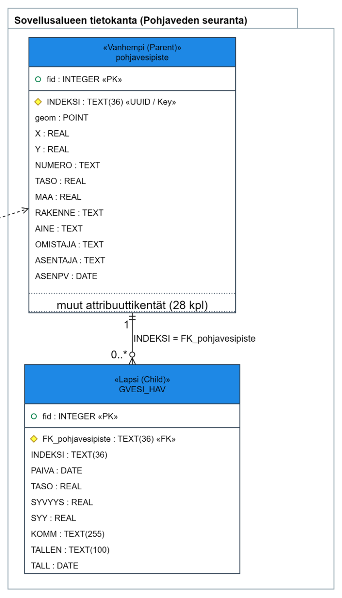

# 0. Ylläpitäjän ohje

Tämä ohje neuvoo Helsingin pohjavesiseurannan QGIS-projektin valmistelussa ja aineiston keräämisessä QFieldillä. Seuraa ohjesivuja järjestyksessä, kun valmistelet projektia ensimmäistä kertaa. Maastossa voit siirtyä suoraan kenttätyöskentelyn ohjeisiin.

## 0.1 Ohjeen eteneminen

Ylläpitäjän ohjeeseen kuuluvat [QGIS-projektin valmistelu](projektin_valmistelu_qgississa_ja_vienti_qfieldiin.md), [lomakemääritykset](lomakemaaritykset.md) ja [QGIS-lomakkeiden muokkausohje](lomakkeiden_muokkaaminen_qgisissa.md). Kun projekti on valmisteltu, siirry [QFieldin käyttöönottoon](1_qfieldin_kayttoonotto.md) ja sen jälkeen [kenttätyöskentelyyn](2_kenttatyoskentely.md).

## 0.2 Aineiston rakenne lyhyesti

Projektissa pohjavesipiste ja siihen liittyvät mittaushavainnot tallennetaan omille tasoilleen:

| Taso | Sisältö | Kytkentä |
|---|---|---|
| **pohjavesipiste** (vanhempi- eli parent-taso) | Putken sijainti ja perustiedot. Pisteen yksilöivä avain on `INDEKSI`. | Pisteellä on geometria. |
| **GVESI_HAV** (lapsi- eli child-taso) | Pisteellä tehdyt mittaushavainnot. | `FK_pohjavesipiste` yhdistää havainnon oikeaan pohjavesipisteeseen. |

Yhdellä pohjavesipisteellä voi olla useita mittaushavaintoja. Lomakemääritykset on kuvattu tarkemmin [lomakemääritysten sivulla](lomakemaaritykset.md), ja havaintojen lisääminen maastossa [kenttätyöskentelyn sivulla](2_kenttatyoskentely.md).
