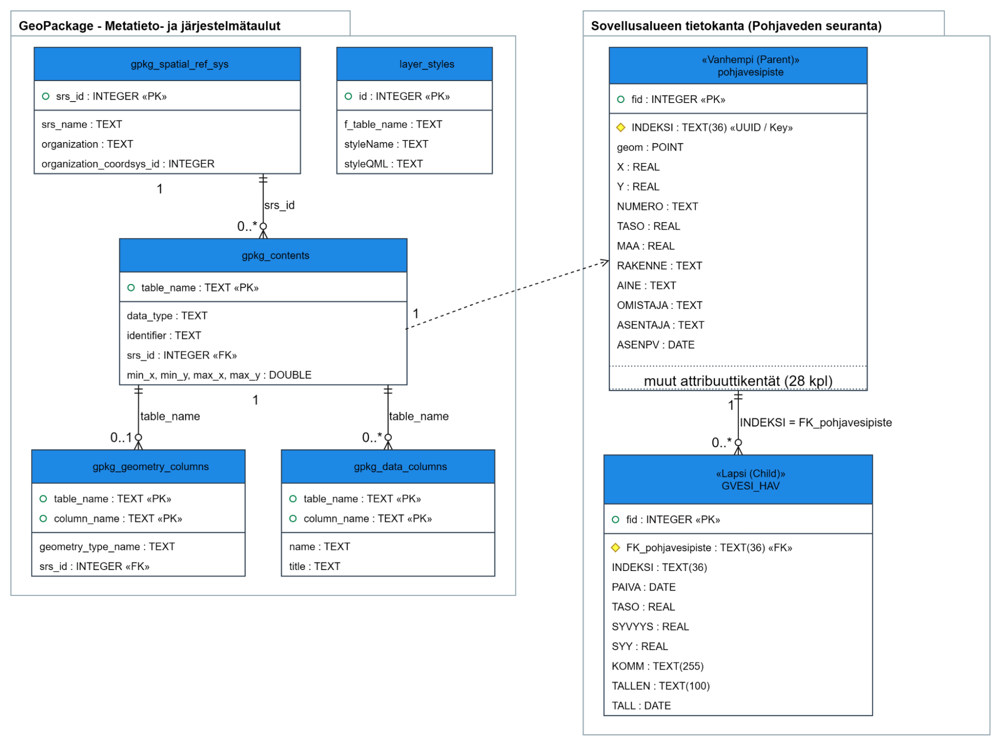

# Johdanto

Tämä ohje neuvoo Helsingin pohjavesiseurannan QGIS-projektin valmistelussa ja aineiston keräämisessä QFieldillä. Seuraa ohjesivuja järjestyksessä, kun valmistelet projektia ensimmäistä kertaa. Maastossa voit siirtyä suoraan kenttätyöskentelyn ohjeisiin.

## Ohjeen eteneminen

Ylläpitäjän ohjeeseen kuuluvat [projektin valmistelu QGISissä ja vienti QFieldiin](2_projektin_valmistelu_qgississa_ja_vienti_qfieldiin.md) sekä [lomakemääritykset](3_lomakemaaritykset.md). Kun projekti on valmisteltu, siirry [alkuvalmisteluun](1_alkuvalmistelu.md) ja [kenttätyöskentelyyn](4_kenttatyoskentely.md).

## Aineiston rakenne lyhyesti

Projektissa pohjavesipiste ja siihen liittyvät mittaushavainnot tallennetaan omille tasoilleen:

| Taso | Sisältö | Kytkentä |
|---|---|---|
| **pohjavesipiste** (vanhempi- eli parent-taso) | Putken sijainti ja perustiedot. Pisteen yksilöivä avain on `INDEKSI`. | Pisteellä on geometria. |
| **GVESI_HAV** (lapsi- eli child-taso) | Pisteellä tehdyt mittaushavainnot. | `FK_pohjavesipiste` yhdistää havainnon oikeaan pohjavesipisteeseen. |

Yhdellä pohjavesipisteellä voi olla useita mittaushavaintoja. Lomakemääritykset on kuvattu tarkemmin [lomakemääritysten sivulla](3_lomakemaaritykset.md), ja havaintojen lisääminen maastossa [kenttätyöskentelyn sivulla](4_kenttatyoskentely.md).
