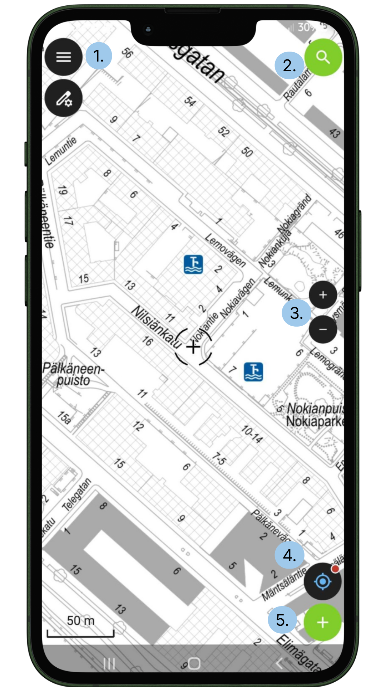
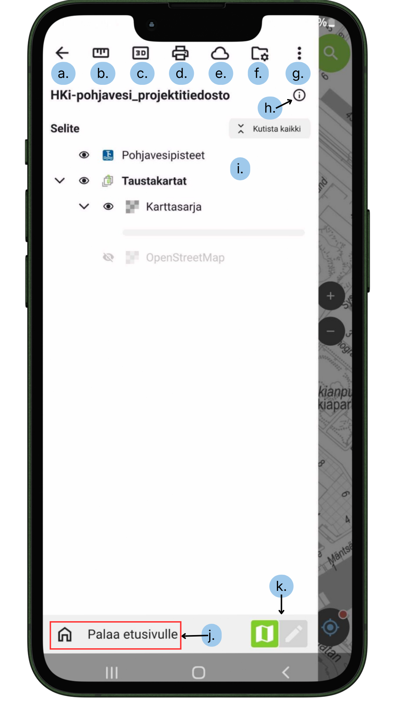
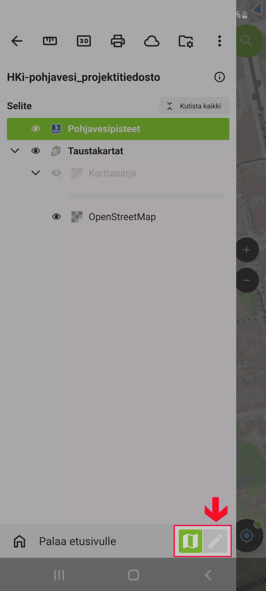
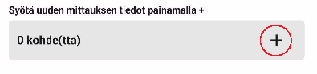
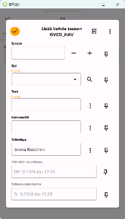

# 2. Kenttätyöskentely QFieldissä

 

 

## 2.1 QField-sovelluksen käyttäjän paikannuksen ohjeistus

Varmista ennen maastoon menoa, että puhelin antaa QFieldille paikannusoikeudet:

1.  **Sijaintioikeudet:** Avaa puhelimen *Asetukset → Sovellukset → QField → Käyttöoikeudet → Sijainti*.
    - Valitse: **Salli vain sovellusta käytettäessä**.
    - Kytke päälle: **Käytä tarkkaa sijaintia** (*Precise location*). Jos tämä ei ole päällä, puhelin arpoo sijainnin tukiasemien perusteella useiden satojen metrien tarkkuudella.
2.  **Virransäästön ohitus:** Avaa puhelimen *Akku / Virransäästö* -asetukset ja aseta QFieldin kohdalle **Rajoittamaton** (*Unrestricted*). Tämä estää puhelinta sammuttamasta GPS-piiriä näytön sammuessa tai taustalla ollessa.
3.  **Mobiilidata ja esteettömyys:** Käynnistä puhelimen sijaintipalvelut avoimen taivaan alla 1–2 minuuttia ennen mittauksia, jotta GPS lataa satelliitit

## 2.2 Paikannustilat ja näytön symbolit QFieldissä

Paikannustoimintoja ohjataan karttanäytön alareunan **tähtäinpainikkeella**:

 

## 2.3 Paikannus ja kohteen mittaus QFieldillä

Tämä ohje kattaa uuden kaivopisteen luomisen GPS-paikannuksella, paikannuksen tarkkuusasetukset sekä työkalut, joiden avulla löydät jo olemassa olevat kohteet maastossa.

### 2.3.1 Havainnon lisääminen pisteelle

1.  Avaa projekti QFieldissä selaustilassa (kts. painike 4 c.)

2.  Valitse kartalta oikea **Pohjavesipiste**.

3.  Avaa kohteen lomake ja siirry **Mittaa**-välilehdelle.

4.  Laita muokkaustila päälle

    

5.  Napsauta relaatiowidgetissä +- painiketta  

6.  Täytä havainnon tiedot (TASO, SYVYYS jne.).

    

7.  Vahvista ja tallenna havainto napsauttamalta 

### 2.3.2 Uuden kaivopisteen mittaus paikannuksella

Jos luot maastossa uutta mitattavaa pohjavesipistettä suoraan GPS-sijaintiisi, toimi seuraavasti:

1.  Kytke **Muokkaustila** päälle vasemman ylakulman valikosta (kynäikoni).

    

2.  Valitse aktiiviseksi tasoksi pohjavesipiste.

3.  Kytke oma paikannus päälle painamalla alareunan tähtäintä.

4.  Siirrä näytön keskellä oleva tähtäin omaan sijaintiisi napauttamalla oikean reunan **Lukitse GPS-sijaintiin** -painiketta. Tähtäin hyppää suoraan sinisen sijaintipisteesi päälle.

    - Jos haluat tallentaa pisteen muuhun kuin sijantiisi, siirrä tähtäinkuvake sormilla oikeaan kohtaan

5.  Tallenna piste valintamerkillä  ja täytä avautuvalle lomakkeelle kaivon tiedot

## 2.4 Kohteen etsintä maastossa (Tarkkuusnäkymä ja äänipalaute)

Kun etsit maastosta olemassa olevaa pistettä (esim. piilotettua pohjavesikaivoa tai vanhaa mittauspistettä), QField tarjoaa tarkan navigointityökalun ja äänipalautteen kohteen löytämiseksi senttimetrien tarkkuudella.

**1. Tarkkuusnäkymä (Precise View):** Kun navigoit valittuun kohteeseen ja saavut määritetyn tarkkuuskynnyksen sisäpuolelle, näytön navigointipaneelin alapuolelle avautuu automaattisesti pyöreä **Tarkkuusnäkymä (Stakeout dial)**.

- Näkymä ohjaa sinut tarkan kohdekoordinaatin päälle visuaalisen tutkakehän avulla.
- QField tulkitsee kohteen saavutetuksi ja värjää näkymän taustan vihreäksi, kun etäisyys kohteeseen miinus paikannuslaitteesi tarkkuus alittaa kymmenesosan (1/10) asettamastasi tarkkuuskynnyksestä. *(Esim. Jos kynnys on 1.0 m ja GPS-tarkkuus 0.05 m, laite näyttää vihreää 0.15 metrin säteellä kohteesta).*

**2. Äänipalaute (Audio feedback):** Jotta sinun ei tarvitse tuijottaa näyttöä kävellessäsi viimeisiä metrejä, QField käyttää äänimerkkejä (ping) heti, kun saavut tarkkuuskynnyksen alueelle. Mitä lähemmäksi kohdetta siirryt, sitä tiheämmin äänimerkki piippaa (kuten auton peruutustutka).

**3. Navigointiasetusten määrittäminen:** Voit säätää tarkkuuskynnystä ja näkymän asetuksia navigointipaneelin yläpalkista painamalla **Asetukset-kuvaketta (☰)**:

- **Äänipalaute (Audio proximity feedback):** Kytkee äänimerkit päälle tai pois.
- **Käännä näkymää (Rotate view):** Määrittää, pyöriikö tutkakehä liikkumisesi mukana vai onko se lukittu pohjoiseen.
- **Käännön lähde (Rotation source):**
  - *Kompassi (Compass):* Kääntää näkymää puhelimen oman magneettikompassin avulla.
  - *Liike (Movement):* Kääntää näkymää GPS-liikkeen suunnan mukaan. Aktivoiduu vasta liikkuessa yli 0.8 km/h, jotta paikallaan seisominen ei pyöritä kompassia.
- **Tarkkuuskynnyksen valitsin (Precision picker):** Tästä voit asettaa etäisyyden, josta tarkkuusnäkymä ja äänipalaute aktivoituvat (esim. 1.0 m).

### 

### 2.4.1 Paikannusasetukset

Virheellisten sijaintitallennusten estämiseksi QFieldiin kannattaa asettaa kiinteät tarkkuusrajat:

1.  Avaa QFieldin päävalikko (hampurilaiskuvake vasemmassa yläkulmassa) ja valitse **Asetukset (hammasratas) → Paikannus (Positioning)**.
2.  Määritä seuraavat asetukset:
    - **Aktivoi tarkkuusindikaattori:** Aseta sopivat arvot Huonon tarkkuuden raja-arvoksi ja Erinomaisen tarkkuuden raja-arvoksi. Tällöin jos satelliittisignaali on liian heikko (esim. sankassa metsässä tai rakennuksen vieressä), QField varoittaa eikä salli pisteen luontia ilman erillistä hyväksyntää.
    - **Ota käyttöön keskimääräinen paikannusvaatimus**
      1.  **Havaintojen vähimmäismäärä:** Aseta tähän esim. 10 havaintoa.
    - **Antennikorkeuden kompensaatio:** Jos puhelinta tai GNSS-sauvaa pidetään mittaustangon päässä, syötä tähän sauvan pituus metreinä, jotta korkeuslukema lasketaan oikein maanpinnalle.

## 2.5 Ulkoisen tarkkuus-GNSS-vastaanottimen käyttö (Valinnainen)

Jos käytössä on erillinen RTK-tarkkuuslaite (kuten Emlid Reach, Trimble, Leica tai Garmin GLO), sen avulla voidaan saavuttaa huomattavasti puhelimen omaa GPS:ää tarkempi sijainti:

1.  Yhdistä vastaanotin puhelimen Bluetooth-asetuksissa.
2.  Avaa QFieldin **Asetukset → Paikannus → Laite (Device)**.
3.  Vaihda *Sisäinen GNSS (Internal)* asetukseen **Bluetooth-laite** ja valitse listalta liitetty vastaanotin.
4.  QField alkaa lukea suoraan laitteen NMEA-dataa, jolloin sijaintitarkkuus kartalla putoaa parhaimmillaan senttimetritasolle ja Z-korkeuslukema vastaa suoraan takymetrimittausta.

## 2.6 Aineiston synkronointi ja laadunvalvonta

1.  **Mobiililaitteessa:** Varmista kenttätyön päätteeksi, että kaikki avoimet lomakkeet on vahvistettu ja tallennettu.
2.  **Synkronointi takaisin järjestelmään:**
    - **Reaaliaikainen WFS/PostGIS:** Muutokset tallentuvat suoraan tietokantaan, kun laite on verkossa.
    - **Offline / GeoPackage -työnkulku:** Yhdistä mobiililaite tietokoneeseen ja suorita QGISissä **Synchronize from QField** -toiminto.
3.  **Laadunvalvonta QGISissä:** Avaa pohjavesipiste-taso ja varmista, että uudet havainnot näkyvät oikein kytkeytyneinä attribuuttitaulukon relaationäkymässä.
