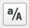

# **Lomakemääritykset ja kenttä-widgetit QFieldissä**

## Tasojen kentät

### **Pohjavesipiste (Vanhempi/Parent-lomake)**

- `INDEKSI`: Piilotettu (Hidden), oletusarvo `uuid('withoutbraces')`.\
- `NUMERO`: Tekstikenttä (pisteen tunnus).\
- `X` ja `Y`: Tekstikentät, joiden automaattiset koordinaattiarvot ovat `round($x, 4)` ja `round($y, 4)`.\
- **Mittaa-välilehti**: Sisältää relaatioviite-widgetin (Relation Reference), jossa näkyvät pisteeseen kytketyt havainnot (`GVESI_HAV`).

### **GVESI_HAV (Lapsi/Child-lomake / Mittaustulokset)**

- `FK_pohjavesipiste`: Relaatioviite (Relation Reference), sitoo havainnon oikeaan pisteeseen.

- `PAIVA`: Päivämäärä-widget (`DateTime`), oletusarvo `now()`.

- `TASO` ja `SYVYYS`: Numeeriset syöttökentät vedenpinnalle ja syvyydelle.

- `SYY`: Arvomappaus (`ValueMap`) mahdollisille poikkeamille.

- `KOMM`: Vapaa tekstikenttä lisätiedoille.

## QGIS-lomakkeiden muokkaaminen ja muotoilu

Seuraavassa osiossa käydään läpi, miten voit muokata tason attribuuttilomaketta QGISissa. Lomakemäärityksillä helpotat tiedonsyöttöä ja vähennät virheitä. Ohje koskee QGISin vektoritasoja; valikoiden nimet voivat vaihdella hieman QGIS-version ja käyttöliittymän kielen mukaan.

1.  Napsauta tasoluettelossa tason nimeä hiiren oikealla painikkeella ja valitse **Ominaisuudet...** (*Properties...*). Voit myös avata ominaisuudet kaksoisnapsauttamalla tasoa.

2.  Valitse vasemmalta **Attribuuttilomake** (*Attributes Form*).

3.  Valitse lomakkeen asettelutapa:

    - **Autogenerate** luo yksinkertaisen lomakkeen, jossa kentät ovat peräkkäin.
    - **Drag-and-drop designer** sopii lomakkeen ryhmittelyyn välilehdiksi ja ryhmiksi.

!!! Note "Huomio"   
    Yksinkertaiseen lomakkeeseen riittää yleensä **Autogenerate**. Kentän asetuksia, kuten aliasta, muokattavuutta ja oletusarvoa, voi säätää kummassakin asettelutavassa valitsemalla kentän lomakkeen kenttälistasta.

### 1.1 Muuta kentän näyttönimeä eli aliasta

1.  Valitse kenttä **Available widgets**- tai lomakeasettelun listasta.
2.  Etsi oikean reunan asetuksista **Alias** ja kirjoita selkeä näyttönimi, kuten *Luontipäivämäärä*.
3.  Alias näkyy esimerkiksi lomakkeella ja attribuuttitaulussa teknisen sarakenimen sijasta. Alias tallentuu QGIS-projektiin.

!!! warning "Huomio"
    Muuta vain kentän näyttönimeä eli aliasta, älä tietokannan kentän nimeä. Näin aineiston tekninen sarakenimi säilyy ennallaan. 
    Voit tarvittaessa vaihtaa lomakemääritykset osioon kenttien nimien tilalle aliakset - painikkeella.

### 1.2 Aseta kenttä vain luku -tilaan

1.  Valitse kenttä ja etsi oikean reunan **Yleiset** -asetuksista **Muokattava**.
2.  Poista valinta, jos kenttää ei saa muokata lomakkeella.

!!! warning "Huomio" 
    Kenttää ei tällöin voi muuttaa käsin QGISin lomakkeella muokkaustilassakaan. Tietolähteen omat käyttöoikeudet ja rajoitukset ovat tästä asetuksesta erillisiä.

### 1.3 Määritä pakollinen kenttä tai muu rajoite

1.  Valitse kenttä ja etsi sen **Ehdot**-asetukset.
2.  Valitse **Ei tyhjä (Not null)**, jos kentälle on annettava arvo. Voit lisätä myös **Uniikki**-rajoitteen tai oman lausekkeen.
3.  Ota vastaavan rajoitteen kohdalla käyttöön **Yksilöllisyysehto on pakottava / Enforce constraint**, jos virheellisen arvon tallentaminen pitää estää.
4.  Lisää omalle lausekkeelle tarvittaessa lyhyt kuvaus, joka auttaa tunnistamaan rajoitteen.

!!! warning "Huomio"
    Pakotettu rajoite estää tallennuksen, kunnes arvo täyttää ehdon. Ilman pakottamista rajoite toimii huomautuksena eikä välttämättä estä tallentamista. 

### 1.4 Aseta oletusarvo

1.  Valitse kenttä ja etsi **Oletusarvot / Default value** -asetus.
2.  Kirjoita kiinteä arvo tai QGIS-lauseke, esimerkiksi:
    - Nykyinen päivämäärä ja aika: `now()`
    - Käyttäjän nimi: `@user_full_name`
    - Käyttöjärjestelmän käyttäjätili: `@user_account_name`
3.  Valitse **Käytä oletusarvoa päivityksessä / Apply default value on update**, jos oletusarvo halutaan laskea uudelleen kohteen muuttuessa.

!!! warning "Huomio"
    Päivitysasetus laskee arvon uudelleen, kun kohteen attribuuttia tai geometriaa muutetaan. Käytä sitä vain, jos haluat arvon päivittyvän myös olemassa oleville kohteille.

### 1.5 Luo valintalista

1.  Valitse kenttä ja aseta **Widget Type** -kohdassa tyypiksi **Value Map**.
2.  Lisää valintalistaan arvot ja kuvaukset:

| Asetus          | Merkitys                      | Esimerkki          |
|-----------------|-------------------------------|--------------------|
| **Value**       | Aineistoon tallennettava arvo | `1`                |
| **Description** | Lomakkeella näytettävä teksti | `Hyvässä kunnossa` |

Valintalista vähentää arvojen kirjoitusvirheitä.

### 1.6 Piilota kenttä lomakkeelta

1.  Valitse kenttä ja vaihda **Widget Type** -asetukseksi **Hidden**.
2.  Kenttä ei tämän jälkeen näy lomakkeella.

!!! warning
    Piilotus koskee vain lomakkeen näkymää. Se ei suojaa tietoa eikä poista kentän sisältöä aineistosta.

### 1.7 Tallenna ja testaa muutokset

1.  Valitse **Käytä** (*Apply*) ja sitten **OK**.
2.  Tallenna QGIS-projekti painamalla `Ctrl + S`.
3.  Avaa lomake ja tarkista, että muutokset toimivat odotetusti.

!!! note
    QGISin lomakeasetukset tallentuvat projektiin. Jos lomaketta käytetään myös QFieldissä, päivitä kenttäkäyttöön vietävä projekti ja testaa lomake QFieldissä.

Lisätietoja: [QGIS 3.44 User Guide: Attributes Form](https://docs.qgis.org/3.44/en/docs/user_manual/working_with_vector/vector_properties.html#vector-attributes-menu).
